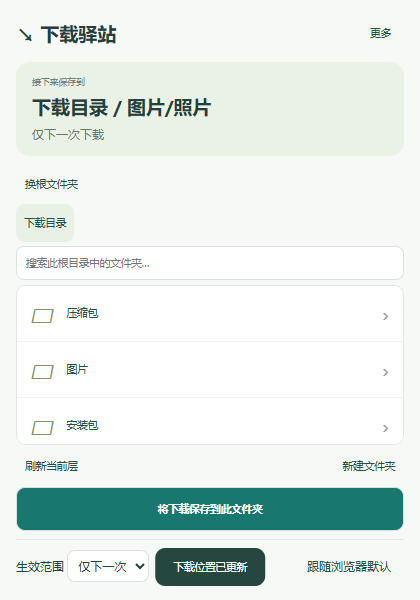

# 下载驿站 · Download Port

在浏览器中选择文件夹，让接下来的下载直接归类。支持接入已有目录、逐层浏览、搜索和下载后归档。

## 能做什么

- 使用已有文件夹作为根目录，不搬动原有文件。
- 整行点击进入子文件夹，通过路径导航返回上级。
- 点击“将下载保存到此文件夹”确认位置；浏览本身不改变下载目标。
- 持续使用一个位置，或仅用于下一次下载；随时恢复浏览器默认下载。
- 按层读取目录，缓存最近浏览的位置；全目录搜索显示进度。
- 新建多级子目录，查看下载记录，备份和恢复设置。
- 自定义位置下载后归档，校验内容、避免覆盖同名文件，保留失败任务供重试。

## 安装

需要 Windows、Chrome 或 Edge（Chromium 120+）以及 **Python 3.10+**。运行 `python --version` 应能显示版本。生产运行无需 Node.js 或第三方 Python 包。

1. 下载发布 ZIP 并解压到长期保留的位置，或获取本仓库源码。
2. 从 **Windows 文件资源管理器**双击 `install.cmd`，看到“本地服务已注册”。无需管理员权限。
3. 打开 `edge://extensions` 或 `chrome://extensions`，启用开发人员模式，选择“加载解压缩的扩展”，加载项目中的 **extension** 文件夹。
4. 将下载驿站固定到工具栏，打开后点击“选择根文件夹”。

本项目尚未发布到浏览器扩展商店，也不含独立打包的 Python 运行时。不要移动或删除正在加载的 extension 文件夹。

## 使用

选择根文件夹时有两种类型：

| 类型 | 如何选择 | 文件如何保存 |
| --- | --- | --- |
| 浏览器当前下载目录 | 手动选择与浏览器下载设置一致的文件夹 | 浏览器直接保存到其相对子目录 |
| 自定义目录 | 选择任意已有文件夹 | 浏览器下载完成后，由本地服务归档到目标 |

工具不会读取或修改浏览器默认下载设置。以后修改浏览器设置时，请同步更换这里的根目录。

进入想要的位置，点击底部 **“将下载保存到此文件夹”**，然后正常下载。顶部显示当前生效目标；“仅下一次”用完后恢复之前的持续位置。“跟随浏览器默认”清除指定位置。

“刷新当前层”只读取当前层；“新建文件夹”相对于当前浏览位置创建。搜索在整个根目录内进行，点击结果进入后再确认位置。下载记录、连接检查和设置备份放在 **“更多”**。

更换根目录需要确认，会重置已选的下载位置；磁盘文件、已有下载任务不受影响。

## 卸载

卸载时先暂停使用并处理待完成任务，然后运行 `uninstall.cmd`，再从浏览器移除扩展。卸载脚本只取消本地服务注册，保留任务数据库和下载文件。

## 数据与边界

- 不向远程服务器发送文件或统计数据。设置保存在浏览器本地；任务数据库位于 `%LOCALAPPDATA%\DownloadPort\data`。
- 扩展使用 downloads、storage、nativeMessaging、alarms 权限，无网页内容脚本和站点访问权限。
- 自定义目录需要先占用浏览器下载盘空间，再进行本地复制与校验；不是直接向任意磁盘下载的网络下载器。
- 同名文件自动编号，不覆盖已有文件。停止归档不删除源文件；异常任务可能留下暂存副本。
- 隐私窗口及其他扩展发起的下载不接管；浏览器“另存为”改变暂存路径时，服务拒绝自动归档。
- 不支持 Firefox、macOS、Linux。NAS、移动硬盘拔出、超大文件、真实断电和企业策略场景尚未完整验收。

更多内容：[常见问题](docs/troubleshooting.md) · [开发与测试](docs/development.md) · [架构](docs/architecture.md) · [验证范围](docs/verification.md) · [发布说明](CHANGELOG.md)

## 贡献者

由 [seelee1](https://github.com/seelee1) 主导设计与验收，OpenAI Codex 协助开发、测试及文档整理。详见 [贡献者](CONTRIBUTORS.md)。

## 许可证

[MIT](LICENSE)。
